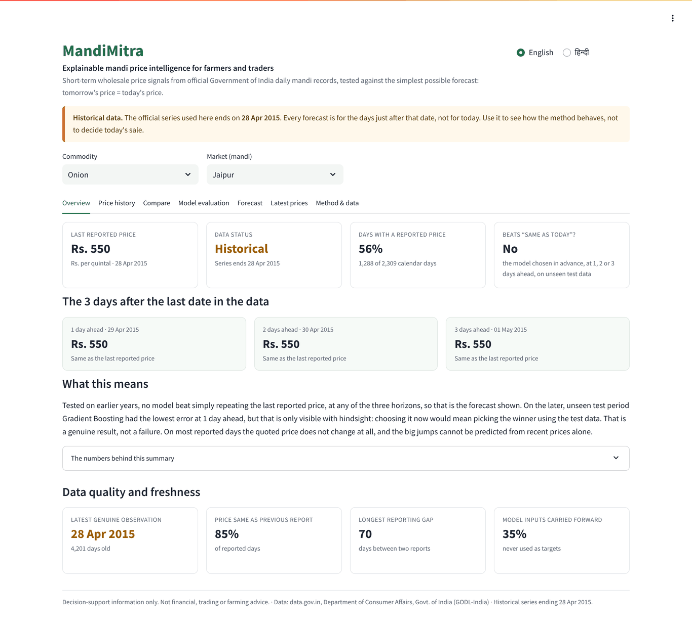
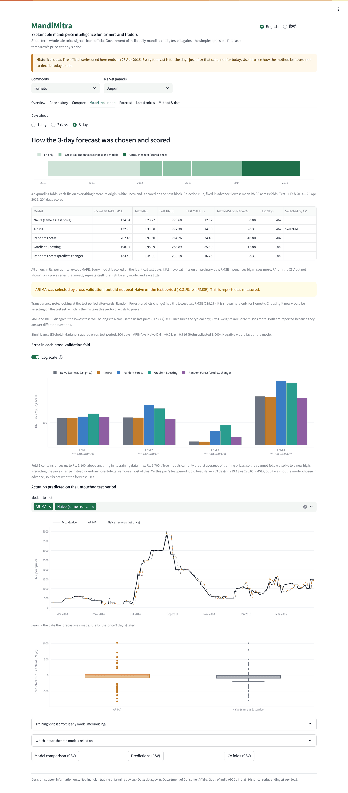

# MandiMitra

**Explainable mandi price intelligence for farmers and traders.**

MandiMitra forecasts wholesale onion and tomato prices 1–3 days ahead from
official Government of India daily mandi records, and tests every model against
the simplest forecast there is: *tomorrow's price = today's price*. It shows
the evidence, including when the answer is "the models don't beat that".

> **Historical data.** The official series ends on **28 April 2015**. Nothing
> here is a current price, and nothing here is financial, trading or farming
> advice.

**Live demo:** <https://mandimitra.streamlit.app/> (Streamlit Community Cloud,
free tier — if it has been idle it takes a moment to wake up). The app also runs
fully offline on a laptop; see *Quick start*.



## The problem

Mandi prices swing hard — Jaipur onion went from Rs. 600–900 a quintal in June
2013 to Rs. 4,500 that October. Plenty of tools now promise AI price
predictions. Before anyone acts on one, two questions matter: *does it beat
simply assuming tomorrow looks like today, and was it tested in a way that
could have shown it doesn't?*

## What it does

- **Real data, traceable.** Department of Consumer Affairs daily wholesale
  prices from data.gov.in, kept untouched with SHA-256 hashes; a test proves the
  working data is an exact extract.
- **Five candidates, one honest yardstick.** Naive, ARIMA, Random Forest,
  Gradient Boosting, and Random Forest predicting the price *change*.
- **A test the models can't game.** Models are chosen by rolling-origin
  cross-validation on 2009–early 2014, then scored **once** on Feb 2014 – Apr
  2015, data they never saw.
- **Missing days handled, not hidden.** A forecast is only ever scored against
  a day the mandi actually reported.
- **Significance, not just scores.** Diebold–Mariano tests (Holm-adjusted) of
  every model against Naive, and a weekly seasonal baseline as a second check.
- **A dashboard for non-specialists:** overview cards with a data-quality and
  freshness panel, price history with reported vs carried-forward days, a
  comparison view, model evaluation with actual-vs-predicted and residual
  charts, the 3-day forecast, and the full method. English and Hindi. CSV
  downloads.
- **Current prices, honestly.** A tested client for the official AGMARKNET
  daily price API (data.gov.in) with validation, paging and all-or-nothing
  updates. It needs a free personal key; without one, the *Latest prices* tab
  says "Not connected" instead of showing anything that looks live.

## What we found

Chosen by cross-validation; test RMSE computed once, afterwards (Rs./quintal).

| Series | Days ahead | Model chosen in advance | Its test RMSE | Naive test RMSE | Beats Naive? |
|---|---:|---|---:|---:|---|
| Onion / Jaipur | 1 | Naive | 94.27 | 94.27 | — (is Naive) |
| Onion / Jaipur | 2 | Naive | 110.29 | 110.29 | — (is Naive) |
| Onion / Jaipur | 3 | Naive | 127.93 | 127.93 | — (is Naive) |
| Tomato / Jaipur | 1 | Random Forest-delta | 127.33 | 120.51 | No (−5.66%) |
| Tomato / Jaipur | 2 | ARIMA | 179.10 | 178.16 | No (−0.53%) |
| Tomato / Jaipur | 3 | ARIMA | 227.38 | 226.68 | No (−0.31%) |

- **No model chosen in advance beat "same as today"** on this data, and Naive
  had the lowest test MAE everywhere.
- **0 of 48** Diebold–Mariano tests found any model more accurate than Naive
  (24 squared-error, 24 absolute-error comparisons).
- On 83–85% of reported days, the quoted price is **identical** to the previous
  report. That is a large part of why Naive is so hard to beat.
- Our **first version** picked the lowest-*test*-error model and reported
  "Gradient Boosting beats Naive by 7.33%". That is selecting on the test set.
  Fixing the protocol removed the win. Both are documented; the old results are
  preserved in `outputs/legacy/`.
- 80% uncertainty ranges built from CV errors covered only 55–74% on test, so
  none are drawn.

This is a result about one mandi, two commodities, 2009–2015, using prices
alone. It is not a claim that forecasting is impossible with better inputs.



## Quick start

Python **3.11 or 3.12** (3.13+ is not supported by the pinned numpy).

```bash
git clone https://github.com/vishnu-keer/mandimitra.git
cd mandimitra
python3 -m venv .venv
source .venv/bin/activate            # Windows: .venv\Scripts\activate
pip install -r requirements.txt
streamlit run app.py                 # http://localhost:8501
```

The repository already contains the data and results, so the app starts
immediately. On a slow connection install in two steps:
`pip install -r requirements-core.txt`, then `requirements-app.txt`.

## Reproduce every number

```bash
python scripts/extract_rajasthan.py          # government files -> Rajasthan subset
python scripts/build_features.py             # clean + features; PHASE 1 GATE
python scripts/run_pipeline.py --all-pairs   # CV, test, forecast; PHASE 2 GATE (~1 min)
python scripts/data_report.py                # docs/DATA_REPORT.md
python scripts/make_manifest.py              # docs/RUN_MANIFEST.md (hashes)
python -m pytest
```

Optional audits, each with its decision rule written in the script before it
ran: `experiment_delta_target.py` (why the fifth model was added),
`experiment_hyperparameter_sensitivity.py` (the tree settings changed one
selection and no conclusion), `experiment_seasonal_naive.py` (a weekly
baseline is far weaker than Naive) and `experiment_significance.py`
(Diebold–Mariano tests).

Current prices (optional): `export DATAGOVIN_API_KEY=…` (free from a
data.gov.in account; never commit it), then
`python scripts/fetch_current_prices.py`. On Streamlit Cloud add the same name
under *Settings → Secrets*.

To check a rebuild against the committed results:

```bash
cp -r outputs /tmp/committed && python scripts/run_pipeline.py --all-pairs
python scripts/check_reproducible.py --reference /tmp/committed
```

## Testing

`python -m pytest` runs **154 tests** in about 25 seconds, with
`FutureWarning`/`DeprecationWarning` treated as errors. They check guarantees,
not just that code runs: no feature can see the future; every model is scored
on identical rows; no training target crosses a boundary; selection never uses
test; only reported prices are scored; the government files are unaltered;
every hash in the run manifest matches its file; the dashboard renders every
series, horizon and language without an exception; and the dashboard cannot
import a model library; current-price ingestion survives schema changes,
failed or partial downloads, and never leaks the API key. Results and commands:
[`docs/TEST_REPORT.md`](docs/TEST_REPORT.md).

The GitHub Actions workflow (`.github/workflows/ci.yml`) repeats the tests on
Python 3.11 and 3.12, rebuilds everything from the government files, checks it
matches the committed results, and starts the app.

## Architecture

```
data.gov.in CSVs ─► extract ─► clean + features ─► CV / test / forecast ─► outputs/*.csv ─► Streamlit (read-only)
   (hashed)                      (Phase 1 gate)        (Phase 2 gate)        (hashed)
```

The dashboard reads files; it trains nothing on page load. Details:
[`docs/ARCHITECTURE.md`](docs/ARCHITECTURE.md).

```
app.py                     Streamlit dashboard (presentation only)
src/                       config, cleaning, features, splits, models, evaluation, intervals,
                           forecast, significance, live_data (current prices)
scripts/                   pipeline steps, reports, audits, reproducibility check
tests/                     154 tests
data/raw/source/           official government files, untouched
data/raw, interim, processed   derived data (regenerable)
outputs/                   results the app reads; legacy/ = first-version results; experiments/
docs/                      methodology, data, architecture, demo runbook, judge Q&A, deploy, reports
research/                  paper (Markdown + PDF), references.bib, figures, key_numbers.json
presentation/              pitch deck (PPTX + PDF), poster, QR codes, build tools
```

## Data and attribution

Source: Department of Consumer Affairs (Price Monitoring Cell), Government of
India, via the Open Government Data Platform India (data.gov.in), under the
Government Open Data License – India. Unit: Rs. per quintal, wholesale.
Coverage 1 Jan 2009 – 28 Apr 2015. Details: [`docs/01_DATA_SOURCE.md`](docs/01_DATA_SOURCE.md)
and [`DATA_LICENSE.md`](DATA_LICENSE.md).

## Limitations

- Historical evaluation only; current prices appear only once an API key is
  configured, and are never used by a model.
- One mandi (Jaipur). Jodhpur and Kota are in the source but report too rarely
  and are excluded, with reasons shown.
- Prices only — no arrivals, weather, MSP, festivals or transport costs.
- About 44–47% of calendar days have no reported price; 35% of model inputs use
  a carried-forward price (never a target).
- Disclosed judgement calls: the validation design was changed once after
  seeing validation results; the tree settings date from the first protocol
  (audited); the fifth model was admitted by a rule written in advance.
- No user study. No claim is made about farmer income or decisions.

## Documentation

| | |
|---|---|
| [`docs/02_METHODOLOGY.md`](docs/02_METHODOLOGY.md) | Every method decision and its measured effect |
| [`docs/01_DATA_SOURCE.md`](docs/01_DATA_SOURCE.md) | Provenance, licence, exclusions |
| [`docs/DATA_REPORT.md`](docs/DATA_REPORT.md) | Coverage per series (generated) |
| [`docs/RUN_MANIFEST.md`](docs/RUN_MANIFEST.md) | Environment, configuration and file hashes (generated) |
| [`docs/ARCHITECTURE.md`](docs/ARCHITECTURE.md) | Pipeline and modules |
| [`docs/DEMO_RUNBOOK.md`](docs/DEMO_RUNBOOK.md) | 30 s / 90 s / 3 / 5 / 10-minute scripts, expected values, fallbacks |
| [`docs/JUDGE_QA.md`](docs/JUDGE_QA.md) | 32 likely questions, answered |
| [`research/MANDIMITRA_RESEARCH_PAPER.md`](research/MANDIMITRA_RESEARCH_PAPER.md) | Preprint (also PDF); verified references in `research/references.bib` |
| [`docs/FINAL_TECHNICAL_REPORT.md`](docs/FINAL_TECHNICAL_REPORT.md) | Full technical report (also PDF) |
| [`presentation/`](presentation/) | Pitch deck (PPTX, PDF), A2 poster, QR codes |
| [`docs/EXECUTIVE_SUMMARY.md`](docs/EXECUTIVE_SUMMARY.md) · [`PROBLEM_STATEMENT`](docs/PROBLEM_STATEMENT.md) · [`COMPETITIVE_LANDSCAPE`](docs/COMPETITIVE_LANDSCAPE.md) · [`IMPACT_AND_MEASUREMENT`](docs/IMPACT_AND_MEASUREMENT.md) · [`USER_RESEARCH_PLAN`](docs/USER_RESEARCH_PLAN.md) · [`PRIVACY_AND_ETHICS`](docs/PRIVACY_AND_ETHICS.md) · [`RISK_REGISTER`](docs/RISK_REGISTER.md) · [`SCALABILITY_AND_SUSTAINABILITY`](docs/SCALABILITY_AND_SUSTAINABILITY.md) · [`BUDGET_AND_ROADMAP`](docs/BUDGET_AND_ROADMAP.md) | Competition documents |
| [`docs/COMPETITION_SHORTLIST.md`](docs/COMPETITION_SHORTLIST.md) · [`SUBMISSION_TEMPLATE`](docs/SUBMISSION_TEMPLATE.md) · [`POSTER_CONTENT`](docs/POSTER_CONTENT.md) · [`DEMO_VIDEO_STORYBOARD`](docs/DEMO_VIDEO_STORYBOARD.md) | Submission material |
| [`docs/COMPETITION_GAP_ANALYSIS.md`](docs/COMPETITION_GAP_ANALYSIS.md) · [`RELEASE_CHECKLIST`](docs/RELEASE_CHECKLIST.md) | Audit and release status |
| [`docs/TEST_REPORT.md`](docs/TEST_REPORT.md) | What was verified, how, and what wasn't |
| [`docs/DEPLOY.md`](docs/DEPLOY.md) | GitHub + Streamlit Community Cloud, step by step |
| `docs/archive/` | Superseded first-version documents, kept for history |

## Licence

Code: MIT (`LICENSE`). Data: GODL-India with attribution (`DATA_LICENSE.md`).
