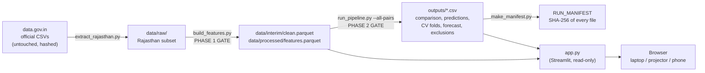

# Architecture

MandiMitra is a batch pipeline that writes plain files, and a thin dashboard
that reads them. Nothing is trained when someone opens the app, and every number
on screen can be traced to a file in `outputs/`.

## Stages

| Stage | Command | Reads | Writes | Gate |
|---|---|---|---|---|
| Extract | `scripts/extract_rajasthan.py` | `data/raw/source/*.csv` | `data/raw/datagovin_daily_wholesale_rajasthan.csv` | provenance test: reproduces the original file byte for byte |
| Clean + features | `scripts/build_features.py` | `data/raw/*.csv` | `clean.parquet`, `features.parquet` | Phase 1: leakage proof, calendar-lag check, coverage gate |
| Evaluate + forecast | `scripts/run_pipeline.py --all-pairs` | features, clean | `outputs/*.csv` | Phase 2: identical rows, embargo, CV-not-test selection, forecast dates after last data |
| Report | `scripts/data_report.py`, `scripts/make_manifest.py` | everything | `docs/DATA_REPORT.md`, `docs/RUN_MANIFEST.md`, `outputs/run_manifest.json` | `tests/test_manifest.py` |
| Serve | `streamlit run app.py` | features, clean, outputs | — | `tests/test_dashboard.py` (headless AppTest) |

## Modules

| Module | Responsibility | Never does |
|---|---|---|
| `src/config.py` | Every path and parameter, in one place | — |
| `src/schema.py` | Map any source's column names to one schema | — |
| `src/store.py` | Parquet with a CSV fallback when pyarrow is absent | — |
| `src/data_prep.py` | Load, parse dates, treat `0` as missing, de-duplicate, calendar-align | invent a value |
| `src/features.py` | Lags, averages, volatility, targets, observed-target masks, leakage proof | look forward |
| `src/splits.py` | Development/test cut, rolling-origin folds, target embargo | shuffle |
| `src/metrics.py` | MAE, RMSE, MAPE, R² with safe handling of undefined cases | — |
| `src/models.py` | Naive, ARIMA, Random Forest, Gradient Boosting, RF-delta behind one interface | see a target it should not |
| `src/evaluate.py` | CV, selection, final test scoring, train diagnostics | select on test |
| `src/intervals.py` | Empirical ranges from CV errors, checked once on test | tune on test |
| `src/forecast.py` | Forward 1–3 day forecast from the last data date, with a plain-language note | call an LLM |
| `src/dashboard_data.py` | Read outputs for the app; descriptive statistics only | import a model library (tested) |
| `app.py` | Presentation: six tabs, English/Hindi, downloads | train or re-score anything |

## Design decisions

- **Files, not a database or API.** Small data, one user at a time, zero cost.
  Results committed to git are their own audit trail.
- **Direct multi-horizon models** (one per horizon) instead of recursive
  forecasting: no compounding errors and no recursive leakage.
- **Read-only dashboard.** Fast for a judge, and the screen cannot disagree with
  the files. A test fails if `app.py` or the data layer imports a model library.
- **Gates that exit non-zero.** The pipeline refuses to write a misleading
  result rather than warning about it.
- **No LLM.** The trend sentence is deterministic, so it is reproducible and
  cannot invent a fact.

## Extending it

- **More markets or commodities:** add the official file to
  `data/raw/source/`, the centre to `config.RAW_CENTRES`, and re-run the
  pipeline. The gate decides whether the series is usable; the app's selectors
  are built from whatever passed.
- **An API or another frontend later:** `src/` has no Streamlit dependency, so
  `outputs/*.csv` and `src/dashboard_data.py` can be served by any web framework
  without touching the ML code.
- **Exogenous inputs** (arrivals, rainfall): new columns in `features.py`; the
  same leakage tests apply automatically.
