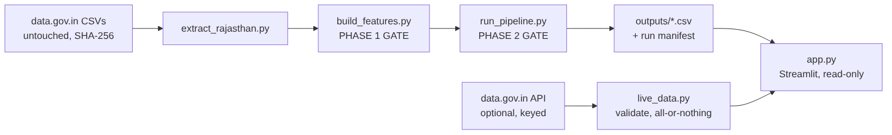

# MandiMitra — Final Technical Report

**Explainable mandi price intelligence** · Vishnu Keer, Vivekananda Global
University, Jaipur · 28 October 2026

Repository <https://github.com/vishnu-keer/mandimitra> · Live app
<https://mandimitra.streamlit.app/>

> **How to read the labels.** **[Measured]** = produced by the released code
> from the released data on 28 Oct 2026 (file named). **[Reported]** = a
> statement from documentation or an external source, cited. **[Estimate]** =
> a judgement, marked as such. **[Proposed]** = future work, not built.

## 1. Executive summary

MandiMitra evaluates 1–3-day-ahead forecasts of daily wholesale onion and
tomato prices (official Department of Consumer Affairs series, Jaipur,
1 Jan 2009 – 28 Apr 2015) against "tomorrow = today", and presents the result
in a bilingual dashboard.

- **[Measured]** The model chosen in advance by rolling-origin cross-validation
  never had a lower test RMSE than Naive: Onion chose Naive at all three
  horizons; Tomato's choices were 5.66%, 0.53% and 0.31% worse
  (`outputs/best_model.csv`).
- **[Measured]** Naive had the lowest test MAE at all six pair-horizons.
- **[Measured]** In 48 Diebold–Mariano comparisons (Holm-adjusted), no model was
  significantly more accurate than Naive (`outputs/experiments/dm_test.csv`).
- **[Measured]** The first version's "7.33% better than Naive" came from
  selecting on the test set; that gap has DM p = 0.505.
- **[Measured]** 83–85% of reported days repeat the previous price; 80%
  forecast ranges covered only 55–74% on test, so no band is drawn.
- **[Measured]** 154 automated tests pass; rebuilds are byte-identical on
  CPython 3.11/3.12; CI is green; the live app was checked in a browser.

The product's value is trustworthy context — a strong reference forecast, data
freshness, stale-quote rates and honest uncertainty — not a leaderboard.

## 2. Problem and target users

Daily mandi prices are volatile (Jaipur onion: Rs. 600–900/q in June 2013,
Rs. 4,500 on 21 Oct 2013 **[Measured]**). Price-prediction tools are promoted
to farmers and traders; their accuracy claims are rarely auditable.

| User | Need | What MandiMitra gives |
|---|---|---|
| Farmer | Should I expect the price to move in the next few days? | The last reported price, a forecast that never claims more than it can show, and whether any model beats "same as today" |
| Trader | How noisy is this market? | Stale-quote rate, reporting gaps, volatility comparison |
| Student / researcher | Is this evaluation trustworthy? | Protocol, tests, hashes, significance, hindsight winners shown separately |
| Market analyst | Can I reuse the data? | Provenance, licence notes, CSV downloads |

**[Reported]** No user research has been conducted; the needs above are
assumptions to be tested (`docs/USER_RESEARCH_PLAN.md`).

## 3. Requirements

**Functional.** Commodity and market selection limited to validated series;
historical trends with reported vs carried-forward days; market comparison;
1/2/3-day forecasts with origin and target dates; model comparison against
Naive with both MAE and RMSE; actual-vs-predicted and residual charts; data
quality and freshness; uncertainty findings; source attribution; CSV
downloads; English/Hindi; current official prices when an API key is
configured.

**Non-functional.** ₹0 hosting; no training on page load; reproducible
outputs; no secrets in the repository; phone-width layout; light theme pinned
for projectors; every number traceable to a file; failures shown as actionable
messages, not tracebacks.

## 4. Architecture



Modules and responsibilities: `docs/ARCHITECTURE.md`. Key decisions: files
not a database (small data, ₹0, auditable in git); direct multi-horizon models
(no recursive leakage); a dashboard that cannot import a model library
(enforced by a test); gates that exit non-zero.

**Data flow.** Official CSV → Rajasthan subset (byte-identical extract) →
clean (zeros → missing, range filter, de-dup) → daily calendar → features and
observed-target masks → CV folds → selection → refit → single test scoring →
forecast and intervals → CSVs → manifest → dashboard.

## 5. Data source and quality

**[Measured]** (`docs/DATA_REPORT.md`): Onion/Jaipur 1,288 reported prices of
1,551 rows (55.8% of calendar days), 1,002 usable 1-day rows; Tomato/Jaipur
1,228 (53.2%), 995. Jodhpur (315/322) and Kota (241/245) fail the 400-row gate.
35% of feature rows use a carried-forward input; no target is ever
carried forward. 84.8% (Onion) and 82.8% (Tomato) of reported days repeat the
previous price. Longest gap between reports: 70 days (Onion/Jaipur).

**[Reported]** Licence: platform Terms of Use require acknowledgement and point
to per-dataset licence metadata, which is absent; GODL-India is the platform
licence per secondary sources; its page redirected to a sign-in
(`docs/01_DATA_SOURCE.md`).

## 6. Feature engineering

Decision point = end of day *t*. Twelve features (price, lags 1/3/7, MAs 3/7,
7-day volatility, 1-day return, deviation from MA, days since report, weekday,
month). Windows need ≥ 60% reported days. Gap fill ≤ 2 days, inputs only —
**[Measured]** 391 / 1,002 / 1,145 usable rows for 1 / 2 / 3 days of fill.
Leakage defences: backward windows (code-scanned), direct targets,
truncate-and-compare proof, future-perturbation test, causal ARIMA filter,
target-date embargo.

## 7. Models

Naive; ARIMA (AIC order, causal h-step Kalman forecasts); Random Forest (300
trees, depth 6, leaf 8); Gradient Boosting (200 stages, lr 0.05, depth 3,
leaf 8, subsample 0.9); Random Forest-delta (predicts the change). Seed 42;
single-threaded trees for bit-exact output.

## 8. Evaluation methodology

Final test = last 20% of dates, scored once after selection. Selection =
lowest mean fold RMSE over 4 expanding rolling-origin folds inside the
development period (rule fixed in advance). Embargo on target dates. Identical
rows per model. MAE and RMSE in Rs./quintal; MAPE in the files only; R² not
shown. Diebold–Mariano (HLN) tests with Holm adjustment. Disclosed judgement
calls: validation redesign after seeing validation results; fifth candidate
admitted on CV; tree settings from the first protocol (audited — one selection
changes under defaults, no conclusion changes).

## 9. Results

**Table 1 [Measured]. Test period, model chosen by CV (Rs./quintal).**

| Series | h | Chosen | Test RMSE | Naive RMSE | vs Naive | Test MAE | Naive MAE |
|---|---:|---|---:|---:|---:|---:|---:|
| Onion | 1 | Naive | 94.27 | 94.27 | 0.00% | 39.75 | 39.75 |
| Onion | 2 | Naive | 110.29 | 110.29 | 0.00% | 53.23 | 53.23 |
| Onion | 3 | Naive | 127.93 | 127.93 | 0.00% | 65.85 | 65.85 |
| Tomato | 1 | RF-delta | 127.33 | 120.51 | −5.66% | 70.92 | 54.27 |
| Tomato | 2 | ARIMA | 179.10 | 178.16 | −0.53% | 99.25 | 90.55 |
| Tomato | 3 | ARIMA | 227.38 | 226.68 | −0.31% | 131.68 | 123.77 |


**Table 2 [Measured]. Every candidate's test RMSE.**

| Series | h | Naive | ARIMA | RF | GBM | RF-delta |
|---|---:|---:|---:|---:|---:|---:|
| Onion | 1 | 94.27 | 96.34 | 93.30 | 87.26 | 93.94 |
| Onion | 2 | 110.29 | 108.94 | 116.58 | 129.44 | 116.34 |
| Onion | 3 | 127.93 | 128.19 | 138.81 | 158.14 | 136.17 |
| Tomato | 1 | 120.51 | 122.16 | 209.42 | 176.76 | 127.33 |
| Tomato | 2 | 178.16 | 179.10 | 263.80 | 241.13 | 176.91 |
| Tomato | 3 | 226.68 | 227.38 | 264.76 | 255.89 | 219.18 |

Lower-than-Naive cells exist (e.g. GBM Onion h=1) but none was chosen in
advance and none is statistically distinguishable from Naive.

## 10. Baseline comparisons

**[Measured]** First version vs now (Onion/Jaipur):

| h | First version (picked on test) | Now (picked by CV) |
|---:|---|---|
| 1 | Gradient Boosting, 87.36, "+7.33%" | Naive, 94.27 |
| 2 | ARIMA, 108.94, "+1.23%" | Naive, 110.29 |
| 3 | Naive, 127.93 | Naive, 127.93 |

**[Measured]** Weekly seasonal naive is far weaker than Naive (mean CV RMSE
Onion 169.5/160.5/168.2 vs 63.0/84.9/117.3; Tomato 215.0/212.9/213.3 vs
79.4/109.7/136.5).

**[Measured]** Diebold–Mariano: squared loss 0 of 24 favour a model, 6 favour
Naive; absolute loss 0 of 24 favour a model, 24 favour Naive.


## 11. Forecast uncertainty

**[Measured]** 80% empirical ranges from CV errors covered 74.0 / 64.7 / 66.8%
(Onion) and 55.3 / 56.7 / 69.6% (Tomato) of test outcomes. None held up; the
dashboard shows this finding instead of a band.


## 12. Testing

**[Measured]** `python -m pytest` → 154 passed (CPython 3.12, clean install).

| Area | File | Tests |
|---|---|---:|
| Leakage | `test_features_no_leakage.py` | 9 |
| Chronology | `test_splits_chronology.py` | 10 |
| Protocol (CV, embargo, identical rows, ARIMA causality) | `test_evaluation_protocol.py` | 33 |
| Forecast validity | `test_forecast_validation.py` | 17 |
| Data validation | `test_data_validation.py` | 19 |
| Metrics | `test_metrics.py` | 10 |
| Provenance | `test_provenance.py` | 5 |
| Manifest + no training in app | `test_manifest.py` | 6 |
| Dashboard (headless AppTest) | `test_dashboard.py` | 15 |
| Current-price ingestion (validation, schema change, paging, failure recovery, key never leaked, staleness) | `test_live_data.py` | 25 |
| Diebold–Mariano | `test_significance.py` | 5 |

Browser checks: 33/33 local (Playwright), plus a manual-equivalent DOM check of
the live app. Details: `docs/TEST_REPORT.md`.

## 13. Performance and deployment

**[Measured]** Pipeline 20–60 s; first page load 2–5 s locally (nothing is
trained on load). Streamlit Community Cloud, Python 3.12 (the platform default
3.14 failed to build the pinned stack — documented in `docs/DEPLOY.md`). CI on
GitHub Actions (3.11 + 3.12): tests, full rebuild, reproducibility check,
server health.

## 14. Security, privacy and licensing

No accounts, cookies set by the app, analytics or personal data. The optional
API key is read from an environment variable or Streamlit secret, never
written, logged or shown (tested). `.gitignore` excludes `.env`, secrets,
virtual environments and fetched snapshots. Code: MIT. Data: GODL-India with
attribution (`DATA_LICENSE.md`); confirm the licence wording manually.

## 15. Limitations

One mandi, two commodities, 2009–2015, price history only; retrospective
only; ~200 test days per horizon; stale quotes; disclosed researcher degrees of
freedom; no user validation; current-data path untested against a real key.

## 16. Cost and sustainability

**[Measured]** ₹0 spent: GitHub (public repo, Actions), Streamlit Community
Cloud, data.gov.in. **[Reported]** Community Cloud: free, public apps, up to
2.7 GB RAM, sleeps after 12 h idle; free tiers can change
(`docs/BUDGET_AND_ROADMAP.md`).

## 17. Roadmap **[Proposed]**

Current data (API key; evaluate the CEDA daily mirror's terms); more markets
through the gate; arrivals and rainfall inputs; prospective scoring of live
forecasts; consented user study; mobile-first Hindi view. Week-by-week plan:
`docs/BUDGET_AND_ROADMAP.md`.

## 18. Reproduction

```bash
git clone https://github.com/vishnu-keer/mandimitra.git && cd mandimitra
python3.12 -m venv .venv && source .venv/bin/activate
pip install -r requirements.txt
python scripts/extract_rajasthan.py
python scripts/build_features.py
python scripts/run_pipeline.py --all-pairs
python scripts/experiment_significance.py
python -m pytest
streamlit run app.py
```

## Appendix A — files

`outputs/best_model.csv`, `model_comparison.csv`, `predictions.csv`,
`cv_folds.csv`, `forecast.csv`, `split_boundaries.csv`, `excluded.csv`,
`feature_importance.csv`, `experiments/*.csv`, `legacy/*.csv`,
`run_manifest.json`.

## Appendix B — references

See `research/MANDIMITRA_RESEARCH_PAPER.md` (references verified against
Crossref or publisher pages; notes in `research/references.bib`).
