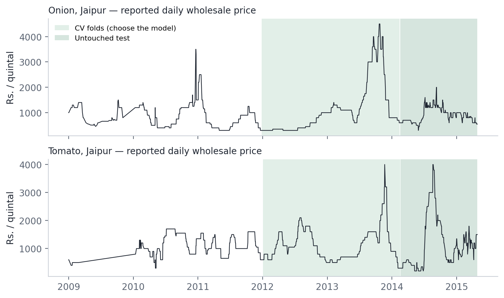
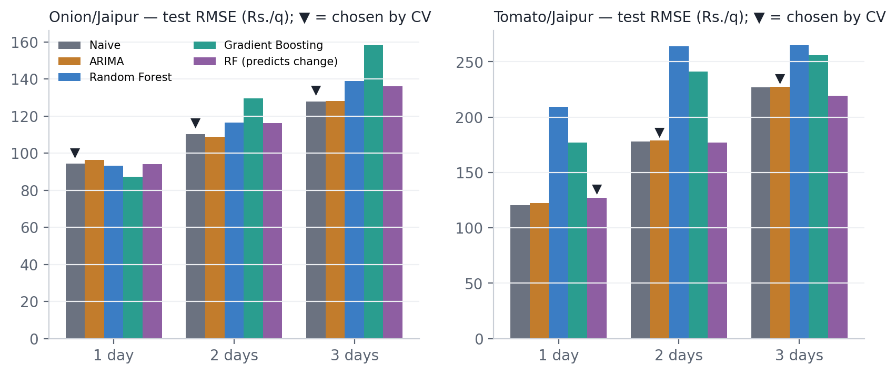
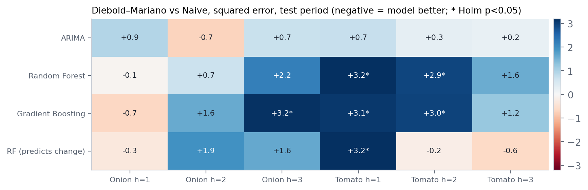
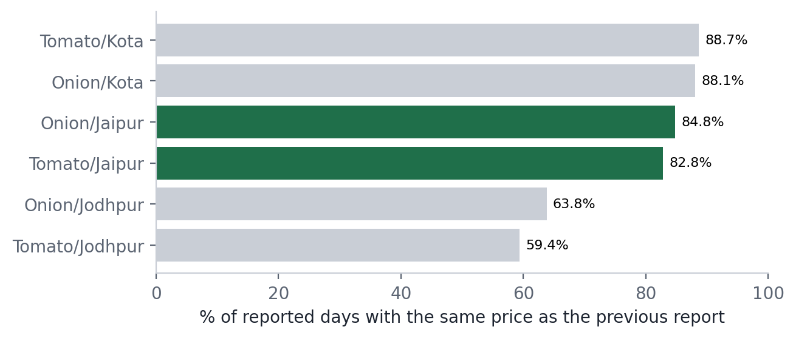
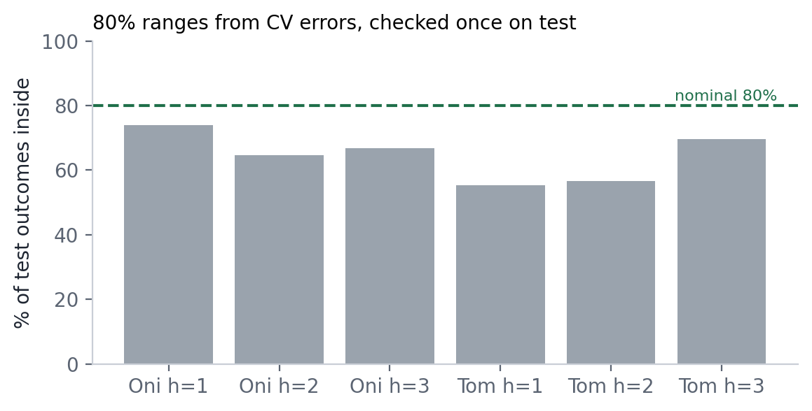

# MandiMitra: An Explainable Framework for Evaluating Short-Horizon Agricultural Market Price Forecasts Using Historical Indian Mandi Data

**Vishnu Keer**, Vivekananda Global University, Jaipur, India

*Preprint, 28 October 2026. Not peer-reviewed.*
*Code and data: <https://github.com/vishnu-keer/mandimitra> · Interactive results: <https://mandimitra.streamlit.app/>*

---

## Abstract

Price-forecasting tools for Indian farmers and traders are increasingly
promoted on the strength of machine-learning accuracy, but the evaluations
behind such claims are often hard to audit. We present MandiMitra, an
open-source framework and bilingual (English/Hindi) dashboard that evaluates
1–3-day-ahead forecasts of daily wholesale onion and tomato prices from the
Department of Consumer Affairs series for Jaipur, 2009–2015, against the
simplest benchmark, "tomorrow equals today". Five candidates — Naive, ARIMA,
Random Forest, Gradient Boosting and a Random Forest that predicts the price
change — are selected by rolling-origin cross-validation inside the development
period and scored once on a held-out final period (February 2014 – April 2015,
about 200 days per horizon). Features use only information available at the
forecast origin, targets are scored only on days the market actually reported,
and training rows whose target dates cross a boundary are removed. The model
chosen in advance never had a lower test RMSE than Naive (Onion: Naive was
chosen at all three horizons; Tomato: −5.66%, −0.53% and −0.31%), and Naive had
the lowest test MAE at all six pair-horizons. Diebold–Mariano tests with
Holm adjustment found no comparison, out of 48, in which a model was
significantly more accurate than Naive. A first version of the project, which
picked the lowest-test-error model, had reported a 7.33% improvement; that
difference (Diebold–Mariano p = 0.505) is not distinguishable from noise. On
83–85% of reported days the quoted price equalled the previous report.
Empirical 80% forecast ranges covered 55–74% of test outcomes. We argue that,
for short-horizon mandi prices from price history alone, an honest benchmark
comparison and transparent uncertainty reporting are more useful to users than
a model leaderboard, and we release every artifact needed to reproduce the
results.

**Keywords:** agricultural price forecasting; naive benchmark; time-series
cross-validation; data leakage; Diebold–Mariano test; India; onion; tomato;
explainable decision support.

---

## 1. Introduction

Onion and tomato prices in India are volatile. In the series studied here,
Jaipur's wholesale onion price rose from Rs. 600–900 per quintal in June 2013
to Rs. 4,500 on 21 October 2013 and fell to about Rs. 800 by December. Such
movements matter to farmers deciding when to sell and to traders deciding how
much to hold, and they motivate a growing number of price-prediction tools.

Accuracy claims for such tools are only as good as the evaluation behind them.
Three problems recur in applied forecasting. First, a model may be chosen
because it had the lowest error on the same data used to report its accuracy,
which overstates performance. Second, information from after the forecast
origin can leak into features, targets or preprocessing (Kaufman et al., 2012).
Third, results are often reported without the simplest benchmark: for many
economic series, "the next value equals the current one" is hard to beat
(Meese and Rogoff, 1983), and a comparison of statistical and machine-learning
methods on the M3 data found the machine-learning methods dominated on
accuracy across horizons (Makridakis, Spiliotis and Assimakopoulos, 2018).

This paper describes MandiMitra, a small, fully reproducible framework built to
make those three problems visible and testable for Indian mandi prices, and
reports what it finds on the data that passed its quality gate. The
contribution is not a new forecasting model. It is (i) an evaluation protocol
whose decision rules were written before the corresponding results were seen
and whose researcher degrees of freedom are disclosed; (ii) automated tests
that would fail if leakage, test-set selection or mismatched scoring rows were
reintroduced; (iii) a worked example in which correcting the protocol removed a
reported improvement; and (iv) a bilingual dashboard that presents these
results, their uncertainty and the data's limitations to non-specialists.

## 2. Problem statement and research questions

Given a daily wholesale price series for one commodity in one mandi, with
missing days, we ask whether forecasts made at the end of day *t* for days
*t+1*, *t+2* and *t+3* can be made more accurate than repeating the price
reported at *t*, using only the price history.

- **RQ1.** Do more complex models (ARIMA, tree ensembles) improve on the naive
  baseline for the available series, when the model is chosen before the final
  test period is scored?
- **RQ2.** How does relative performance change with horizon (1–3 days)?
- **RQ3.** How do missing reports and stale quotes affect what can be learned
  and how results should be presented?
- **RQ4.** Can forecast uncertainty be communicated reliably with a simple
  distribution-free method on this data?

We do not ask whether the forecasts improve farmers' incomes; no user study was
conducted (Section 10).

## 3. Related work

**Benchmarks and accuracy measures.** Hyndman and Athanasopoulos (2021, §5.2)
define the naive forecast as the last observation and the seasonal naive
forecast as the last observation from the same season; both are standard
benchmarks. Hyndman and Koehler (2006) review the properties and pitfalls of
scale-dependent and percentage error measures such as MAE, RMSE and MAPE.
Meese and Rogoff (1983) is the classic demonstration, for exchange rates, that
structural models did not beat a random walk out of sample. In the M4
competition (Makridakis, Spiliotis and Assimakopoulos, 2020), simple benchmarks
were included as reference points for 61 methods on 100,000 series; we use it
only as context. Makridakis, Spiliotis and Assimakopoulos (2018) compared
machine-learning and statistical methods on 1,045 monthly M3 series and found
the machine-learning methods were dominated by the statistical ones on both
accuracy measures and at all horizons.

**Evaluating time-series forecasts.** Tashman (2000) reviews out-of-sample
evaluation, including rolling-origin designs. Bergmeir and Benítez (2012)
study cross-validation choices for time-series predictors. Cerqueira, Torgo
and Mozetič (2020) compare performance-estimation methods empirically and find
that for non-stationary series, out-of-sample (holdout-style) estimates were
the most accurate. Kaufman et al. (2012) formalise leakage and how to detect
and avoid it. Diebold and Mariano (1995) propose a test of equal predictive
accuracy, and Harvey, Leybourne and Newbold (1997) give a small-sample
correction, which we use. Lei et al. (2018) describe split-conformal predictive
inference; its coverage guarantee rests on exchangeability, which a
non-stationary price series does not satisfy.

**Agricultural prices in India.** Birthal, Negi and Joshi (2019) associate
onion price volatility in India with uncertainty in market arrivals rather than
production shocks, and find that export restrictions had no immediate cooling
effect — a reminder that price history alone omits the main drivers. Paul et
al. (2022) compare machine-learning methods (GRNN, SVR, Random Forest, Gradient
Boosting) with ARIMA for brinjal prices in 17 Odisha markets, find GRNN best,
and use Diebold–Mariano tests; the abstract does not report a random-walk
benchmark. Avinash et al. (2024) forecast weekly tomato, onion and potato
prices for Azadpur (Delhi), 2006–2023, with hidden-Markov-model/deep-learning
hybrids against standalone deep models; no naive benchmark is reported and
Diebold–Mariano significance holds only in some cases. Our work differs in
scope (daily, 1–3 days, two series) and purpose: it asks first whether any
candidate beats the naive benchmark under a protocol that cannot select on the
test period, and reports significance for every comparison.

**Tools.** We use scikit-learn (Pedregosa et al., 2011) for Random Forest
(Breiman, 2001) and Gradient Boosting (Friedman, 2001), and statsmodels
(Seabold and Perktold, 2010) for ARIMA.

## 4. Data, provenance and licensing

**Source.** Daily wholesale prices of onion and tomato published by the
Department of Consumer Affairs, Price Monitoring Cell, on the Open Government
Data Platform India (data.gov.in), 1 January 2009 to 28 April 2015, for 73
centres nationally (DCA, 2015). Unit: Rs. per quintal, as published. A price of
0 is the source's code for "not reported".

**Provenance.** The two official files are stored unaltered with SHA-256
hashes. A script extracts the Rajasthan centres; a test proves that, restricted
to Jaipur/Onion, it reproduces the project's original raw file byte for byte.
Every input and output file is hashed in a generated run manifest.

**Licensing.** The platform's Terms of Use require that the source be
prominently acknowledged and refer to per-dataset licence metadata; the
catalogue records for these datasets carry no explicit licence field. The
Government Open Data License – India (GODL, 2017) is the licence associated
with the platform; its text could not be read from the official page during
this study (Section 10). The code is MIT-licensed; that licence does not cover
the data.

**Series that passed the gate.** A series is evaluated only if it has at least
400 rows with a complete feature vector and a genuinely reported 1-day target —
a threshold fixed before any Rajasthan series was examined.

**Table 1. Coverage of the Rajasthan series (1 Jan 2009 – 28 Apr 2015).**

| Series | Raw rows | Reported prices | Reporting % | Usable 1-day rows | Gate |
|---|---:|---:|---:|---:|---|
| Onion / Jaipur | 1,551 | 1,288 | 55.8 | 1,002 | evaluated |
| Tomato / Jaipur | 1,551 | 1,228 | 53.2 | 995 | evaluated |
| Onion / Jodhpur | 1,122 | 625 | 37.4 | 315 | excluded |
| Tomato / Jodhpur | 1,122 | 626 | 37.4 | 322 | excluded |
| Onion / Kota | 1,105 | 470 | 45.8 | 241 | excluded |
| Tomato / Kota | 1,105 | 470 | 45.8 | 245 | excluded |

*Reporting % is days with a reported price over calendar days in the series'
own span. Source: `docs/DATA_REPORT.md`, generated from the files.*



## 5. Cleaning and feature engineering

Zeros are treated as missing; prices outside Rs. 50–100,000 per quintal are
rejected; duplicates are removed. Each series is placed on a continuous daily
calendar so that a one-day lag always refers to the previous calendar day — an
earlier version of the project dropped gap rows before computing lags, which
silently made "yesterday" mean "the previous report"; a calendar-lag check now
guards against this. A missing day may carry the last reported price forward
as an *input* for at most two days (chosen by measuring usable rows: one day
gave 391 usable 1-day rows on Onion/Jaipur, two days 1,002, three days 1,145);
longer gaps stay empty. About 35% of feature rows use a carried-forward price.

The decision point is the end of day *t*. Twelve features use data up to and
including *t*: the price at *t*; lags of 1, 3 and 7 days; 3- and 7-day moving
averages; 7-day volatility; the 1-day return; deviation from the 7-day average;
days since the last report; day of week; month. Windows measured in calendar
days require at least 60% of their days to be reported. Targets are the prices
at *t+1*, *t+2*, *t+3*, and a row is used for training or scoring **only if the
target day was actually reported**. Before this rule, about 40% of 1-day
targets would have been carried-forward values, which would have handed the
naive benchmark free exact hits.

Leakage defences, each enforced by an automated test: backward-only windows
(a code scan fails the build if back-filling or interpolation appears);
direct multi-horizon models (no prediction is fed back as an input);
a truncate-and-compare proof that features before a cut date are unchanged when
later data are deleted; a perturbation test in which multiplying future prices
by ten leaves earlier features unchanged; and a causal ARIMA filter whose
forecasts are shown not to depend on later prices.

## 6. Forecasting methods

- **Naive:** \(\hat y_{t+h} = y_t\).
- **ARIMA:** order selected by AIC on the fitting window from seven candidates
  (all with one difference); h-step forecasts from every origin by a single
  causal Kalman-filter pass with parameters estimated on the fitting window.
- **Random Forest** (300 trees, depth 6, minimum leaf 8, square-root feature
  sampling) and **Gradient Boosting** (200 stages, learning rate 0.05, depth 3,
  minimum leaf 8, subsample 0.9), one model per horizon, predicting the price
  level.
- **Random Forest-delta:** as Random Forest but predicting \(y_{t+h} - y_t\),
  then adding \(y_t\) back. Level-predicting trees output averages of training
  targets and so cannot forecast above the highest price they were trained on;
  in the cross-validation fold containing the October 2013 spike, the level
  trees could not predict above Rs. 2,197 per quintal.

The fifth candidate was admitted by an experiment run under a rule written
before it ran: a change-predicting variant joins the candidates only if its
mean cross-validation RMSE beats Naive at one or more horizons. Random
Forest-delta did so on Tomato/Jaipur (1 and 3 days); a Gradient Boosting
variant did not anywhere and was not added.

## 7. Evaluation protocol

The last 20% of distinct dates of each series form the **final test period**
(17 February 2014 – 27 April 2015 for Onion at 1 day; boundaries differ slightly
by series and horizon), scored once after selection. Inside the earlier
development period, **rolling-origin cross-validation** (Tashman, 2000) uses
four expanding folds over its second half: each fold fits on everything before
its origin and is scored on the following block. **The selection rule, fixed
before the results were seen, is the lowest mean per-fold RMSE.** A mean of
folds, rather than a pooled RMSE, prevents one spike fold from deciding alone.
An **embargo** removes any training row whose target date reaches past a fold
origin or the test cut-off. Within each fold and on test, every candidate is
scored on **identical rows**. Final models are refitted on the whole
development period.

Point accuracy is reported as MAE and RMSE in Rs. per quintal; MAPE is in the
outputs but is not used for decisions because it is asymmetric and unstable
near zero (Hyndman and Koehler, 2006). R² is not reported on screen because on
a series that mostly repeats itself it is high for any model.

Significance is assessed with the Diebold–Mariano test (Diebold and Mariano,
1995) with the Harvey–Leybourne–Newbold correction (Harvey, Leybourne and
Newbold, 1997), autocovariances to lag h−1, on the identical test days, under
squared and absolute loss, with Holm adjustment across the four model-versus-
Naive comparisons in each pair-horizon.

For uncertainty, an 80% range is formed from the selected method's
out-of-fold cross-validation errors (a split-conformal-style construction,
Lei et al., 2018) and checked once on the test period. A range "holds up" if
test coverage is within ten percentage points of nominal.

**Development history and disclosed degrees of freedom.** The first version
of the project (September 2026) reported the lowest-test-RMSE model as "best"
and split on the feature date without an embargo; its results are preserved,
not overwritten. The current protocol replaced it. Three further judgement
calls were made with knowledge of non-test results and are disclosed: (a) the
validation design was changed from a single block to rolling folds after the
single block was seen to fall on one price spike; (b) the fifth candidate was
admitted on cross-validation; (c) the tree settings were fixed under the first
protocol, when their effect on the old test window had been observed. Item (c)
is audited in Section 8.4.

## 8. Results

### 8.1 Main comparison (RQ1, RQ2)

**Table 2. Final test period. Selection by cross-validation; test scored once,
afterwards. Rs. per quintal.**

| Series | h | Chosen by CV | CV mean fold RMSE | Test RMSE | Naive test RMSE | vs Naive | Test MAE | Naive test MAE | n |
|---|---:|---|---:|---:|---:|---:|---:|---:|---:|
| Onion/Jaipur | 1 | Naive | 61.53 | 94.27 | 94.27 | 0.00% | 39.75 | 39.75 | 200 |
| Onion/Jaipur | 2 | Naive | 90.40 | 110.29 | 110.29 | 0.00% | 53.23 | 53.23 | 201 |
| Onion/Jaipur | 3 | Naive | 122.77 | 127.93 | 127.93 | 0.00% | 65.85 | 65.85 | 205 |
| Tomato/Jaipur | 1 | RF-delta | 75.68 | 127.33 | 120.51 | −5.66% | 70.92 | 54.27 | 199 |
| Tomato/Jaipur | 2 | ARIMA | 106.03 | 179.10 | 178.16 | −0.53% | 99.25 | 90.55 | 201 |
| Tomato/Jaipur | 3 | ARIMA | 132.99 | 227.38 | 226.68 | −0.31% | 131.68 | 123.77 | 204 |

*Source: `outputs/best_model.csv`, `outputs/model_comparison.csv`. "vs Naive"
is the percentage reduction in test RMSE; negative means worse than Naive.*



The model chosen in advance never had a lower test RMSE than Naive (RQ1).
Naive had the lowest test MAE at all six pair-horizons. Errors grow with
horizon for every method (RQ2), and no horizon shows a pattern in which a
complex model becomes useful.

**Hindsight winners.** Looking at the test period afterwards, a different
model had the lowest test RMSE at five of six pair-horizons: Gradient Boosting
for Onion at 1 day (87.26), ARIMA for Onion at 2 days (108.94), Naive for
Tomato at 1 day (120.51), and Random Forest-delta for Tomato at 2 and 3 days
(176.91, 219.18). These are reported for transparency and were not used for
selection. Gradient Boosting's cross-validation RMSE for Onion at 1 day was
229.03 — almost four times Naive's 61.53 and second-worst of the five (only
Random Forest, 275.19, was worse) — illustrating how unstable such a "winner"
is.

### 8.2 Significance

**Table 3. Diebold–Mariano tests, every model against Naive on the identical
test days, Holm-adjusted within each pair-horizon (24 comparisons per loss).**

| Loss | Model significantly better (p<0.05) | Naive significantly better | Not distinguishable |
|---|---:|---:|---:|
| Squared error | 0 | 6 | 18 |
| Absolute error | 0 | 24 | 0 |

*Source: `outputs/experiments/dm_test.csv`.*



No comparison, under either loss, found a model significantly more accurate
than Naive. The Tomato 1-day choice (Random Forest-delta) was significantly
worse than Naive under squared error (DM = 3.18, Holm-adjusted p = 0.007). The
first version's headline — Gradient Boosting 7.33% better than Naive for Onion
at 1 day — corresponds to DM = −0.67, p = 0.505. The absolute-loss result
partly reflects that Naive is exactly right on every day the quoted price does
not change.

### 8.3 A second baseline

A weekly seasonal naive forecast (\(\hat y_{t+h} = y_{t+h-7}\)) was evaluated on
the same folds under a rule fixed beforehand (it would replace Naive as the
reference only if better at every horizon of a series). Its mean
cross-validation RMSE was far higher: Onion 169.5 / 160.5 / 168.2 against Naive's
63.0 / 84.9 / 117.3, Tomato 215.0 / 212.9 / 213.3 against 79.4 / 109.7 / 136.5
(h = 1, 2, 3; rows where both baselines exist). Naive remains the reference.

### 8.4 Sensitivity to the tree settings

Re-running every tree candidate with scikit-learn's default settings on the
same folds changed one selection: Tomato at 1 day would choose ARIMA instead
of Random Forest-delta. ARIMA's test RMSE there (122.16) is also above Naive's
(120.51), so no conclusion changes. Random Forest-delta's admission does
depend on the regularised settings (its mean CV RMSE at Tomato h = 1 is 91.2
with defaults, against Naive's 76.9).

### 8.5 Data quality (RQ3)

On 84.8% (Onion) and 82.8% (Tomato) of reported Jaipur days, the quoted price
equalled the previous report (Figure 5). Prices move in occasional steps rather
than continuously, which favours the naive benchmark on ordinary days and
leaves the large steps — the costly errors — unpredictable from price history.
About 44–47% of calendar days have no report, so 35% of model inputs use a
carried-forward price; none is ever used as a target.



### 8.6 Uncertainty (RQ4)

Empirical 80% ranges built from cross-validation errors covered 74.0%, 64.7% and
66.8% of Onion test outcomes and 55.3%, 56.7% and 69.6% of Tomato outcomes
(h = 1, 2, 3). None held up by the pre-set criterion, and the range nearest to
nominal (Onion, 1 day) had zero width because most cross-validation errors
were exactly zero. The dashboard therefore reports the coverage check instead
of drawing a band.



## 9. Discussion

For these two series, price history alone did not support forecasts better
than "tomorrow equals today" at 1–3 days. This agrees with the long-standing
difficulty of beating random-walk-type benchmarks for economic prices (Meese
and Rogoff, 1983) and with large-scale comparisons in which machine-learning
methods did not outperform statistical ones (Makridakis et al., 2018). It also
fits the finding that onion price volatility is associated with arrivals
uncertainty (Birthal et al., 2019): the information that might predict a price
step is not in the price series.

The corrected protocol changed a reported 7.33% improvement into no detectable
improvement. Nothing about the data or models changed; only the rule for
choosing the winner did. This is the practical case for selecting on
validation data, scoring the test once, testing significance, and publishing
the hindsight winners alongside the chosen model rather than in its place.

For users, the useful outputs are therefore not a confident forecast but:
which simple reference to trust; how often the price actually moves; how
uncertain any forecast is; and how stale the data are. The dashboard is built
around those, in English and Hindi, with every figure traceable to a file.

## 10. Limitations and threats to validity

- **One mandi, two commodities, 2009–2015.** Results may not hold elsewhere or
  now. They are not evidence that forecasting is impossible with richer inputs.
- **Retrospective only.** No forecast was checked prospectively.
- **Price history only.** No arrivals, weather, policy or festival data.
- **Gaps and stale quotes.** Reporting density near 55%; most reported prices
  unchanged. Part of this may reflect recording practice rather than trading.
- **Test window length.** About 200 scored days per horizon limits power;
  "not distinguishable" is not "equal".
- **Regime change.** The test period follows the 2013 spike and is more
  volatile than most of the development period.
- **Researcher degrees of freedom.** Disclosed in Section 7 and audited where
  possible (Section 8.4); a prospective study would remove them.
- **Licensing.** The licence text was not read from the official page.

## 11. Responsible use and societal impact

The dashboard states on every screen that the data are historical and that
nothing it shows is financial, trading or farming advice. Forecasts are shown
next to the last reported price and the naive reference, never alone. No
personal data are collected; the app has no accounts or tracking. A tool that
overstated accuracy could lead a farmer to hold or sell at the wrong time; the
design choice here is to understate rather than overstate. Any future
deployment with current data should be preceded by a consented user study
(the project includes a plan) and should keep the benchmark comparison visible.

## 12. Reproducibility

All code, the two untouched source files, every derived file and every result
are in the public repository, with pinned dependencies, a fixed seed and a
generated manifest of SHA-256 hashes. Rebuilding from the government files
gives byte-identical results under CPython 3.11 and 3.12 on Linux; on other
platforms only ARIMA output moves, by hundredths of a rupee, within a tolerance
checked by a script. 154 automated tests cover leakage, chronology, embargo,
identical scoring rows, provenance, the manifest, data validation and the
dashboard. Continuous integration rebuilds everything from the source files on
each push.

```
python scripts/extract_rajasthan.py
python scripts/build_features.py
python scripts/run_pipeline.py --all-pairs
python scripts/experiment_significance.py
python -m pytest
```

## 13. Conclusion and future work

Under a protocol that cannot select on the test period, none of four
non-trivial forecasting methods beat "tomorrow equals today" for daily onion and
tomato wholesale prices in Jaipur at 1–3 days, and no difference in a model's
favour was statistically detectable. We suggest that applied agricultural
price-forecasting work report a naive benchmark, select without the test
period, test significance, and publish its hindsight winners.

Future work: (1) current data — the framework includes a validated client for
the official AGMARKNET-sourced daily price API, pending an access key;
(2) more markets and commodities through the same gate; (3) arrivals and
weather inputs, where an edge is more plausible; (4) prospective evaluation,
scoring forecasts against prices published after they were made; (5) a
consented user study of whether the explanations help traders and farmers.

## Acknowledgements and declarations

Data: Department of Consumer Affairs, Government of India, via data.gov.in.
No funding was received. The author declares no competing interests. AI
assistance was used for software development and drafting; all numbers were
generated by the released code from the released data and checked against the
output files.

## References

Avinash, G., Ramasubramanian, V., Paul, R. K., Ray, M., Dahiya, S., Iquebal,
M. A., Godara, S. and Manjunatha, B. (2024). Price forecasting of TOP (tomato,
onion and potato) commodities using hidden Markov-based deep learning approach.
*Statistics and Applications*, 22(2), 63–90.
<https://www.ssca.org.in/media/4_SA99102023_R2_SA_26112023_V_99yqeAF._Ramasubramanian_FINAL_Finally.pdf>

Bergmeir, C. and Benítez, J. M. (2012). On the use of cross-validation for time
series predictor evaluation. *Information Sciences*, 191, 192–213.
<https://doi.org/10.1016/j.ins.2011.12.028>

Birthal, P. S., Negi, A. and Joshi, P. K. (2019). Understanding causes of
volatility in onion prices in India. *Journal of Agribusiness in Developing and
Emerging Economies*, 9(3), 255–275. <https://doi.org/10.1108/JADEE-06-2018-0068>

Breiman, L. (2001). Random forests. *Machine Learning*, 45(1), 5–32.
<https://doi.org/10.1023/A:1010933404324>

Cerqueira, V., Torgo, L. and Mozetič, I. (2020). Evaluating time series
forecasting models: an empirical study on performance estimation methods.
*Machine Learning*, 109(11), 1997–2028. <https://doi.org/10.1007/s10994-020-05910-7>

DCA (2015). Department of Consumer Affairs, Price Monitoring Cell. *Daily
wholesale price of Onion / Tomato upto April 2015.* Open Government Data
Platform India. <https://data.gov.in/sites/default/files/daily_wholesale_price_Onion_upto_apr_2015.csv>
(retrieved 27 October 2026).

Diebold, F. X. and Mariano, R. S. (1995). Comparing predictive accuracy.
*Journal of Business & Economic Statistics*, 13(3), 253–263.
<https://doi.org/10.1080/07350015.1995.10524599>

Friedman, J. H. (2001). Greedy function approximation: a gradient boosting
machine. *The Annals of Statistics*, 29(5), 1189–1232.
<https://doi.org/10.1214/aos/1013203451>

GODL (2017). Government of India. *Government Open Data License – India.*
<https://www.data.gov.in/Godl>

Harvey, D., Leybourne, S. and Newbold, P. (1997). Testing the equality of
prediction mean squared errors. *International Journal of Forecasting*, 13(2),
281–291. <https://doi.org/10.1016/S0169-2070(96)00719-4>

Hyndman, R. J. and Athanasopoulos, G. (2021). *Forecasting: Principles and
Practice* (3rd ed.). OTexts. <https://otexts.com/fpp3/>

Hyndman, R. J. and Koehler, A. B. (2006). Another look at measures of forecast
accuracy. *International Journal of Forecasting*, 22(4), 679–688.
<https://doi.org/10.1016/j.ijforecast.2006.03.001>

Kaufman, S., Rosset, S., Perlich, C. and Stitelman, O. (2012). Leakage in data
mining: formulation, detection, and avoidance. *ACM Transactions on Knowledge
Discovery from Data*, 6(4), 1–21. <https://doi.org/10.1145/2382577.2382579>

Lei, J., G'Sell, M., Rinaldo, A., Tibshirani, R. J. and Wasserman, L. (2018).
Distribution-free predictive inference for regression. *Journal of the
American Statistical Association*, 113(523), 1094–1111.
<https://doi.org/10.1080/01621459.2017.1307116>

Makridakis, S., Spiliotis, E. and Assimakopoulos, V. (2018). Statistical and
machine learning forecasting methods: concerns and ways forward. *PLOS ONE*,
13(3), e0194889. <https://doi.org/10.1371/journal.pone.0194889>

Makridakis, S., Spiliotis, E. and Assimakopoulos, V. (2020). The M4
Competition: 100,000 time series and 61 forecasting methods. *International
Journal of Forecasting*, 36(1), 54–74. <https://doi.org/10.1016/j.ijforecast.2019.04.014>

Meese, R. A. and Rogoff, K. (1983). Empirical exchange rate models of the
seventies. *Journal of International Economics*, 14(1–2), 3–24.
<https://doi.org/10.1016/0022-1996(83)90017-X>

Paul, R. K., Yeasin, M., Kumar, P., Kumar, P., Balasubramanian, M., Roy, H. S.,
Paul, A. K. and Gupta, A. (2022). Machine learning techniques for forecasting
agricultural prices: a case of brinjal in Odisha, India. *PLOS ONE*, 17(7),
e0270553. <https://doi.org/10.1371/journal.pone.0270553>

Pedregosa, F., Varoquaux, G., Gramfort, A. et al. (2011). Scikit-learn: machine
learning in Python. *Journal of Machine Learning Research*, 12, 2825–2830.
<https://jmlr.org/papers/v12/pedregosa11a.html>

Seabold, S. and Perktold, J. (2010). Statsmodels: econometric and statistical
modeling with Python. *Proceedings of the 9th Python in Science Conference*,
92–96. <https://doi.org/10.25080/Majora-92bf1922-011>

Tashman, L. J. (2000). Out-of-sample tests of forecasting accuracy: an analysis
and review. *International Journal of Forecasting*, 16(4), 437–450.
<https://doi.org/10.1016/S0169-2070(00)00065-0>
